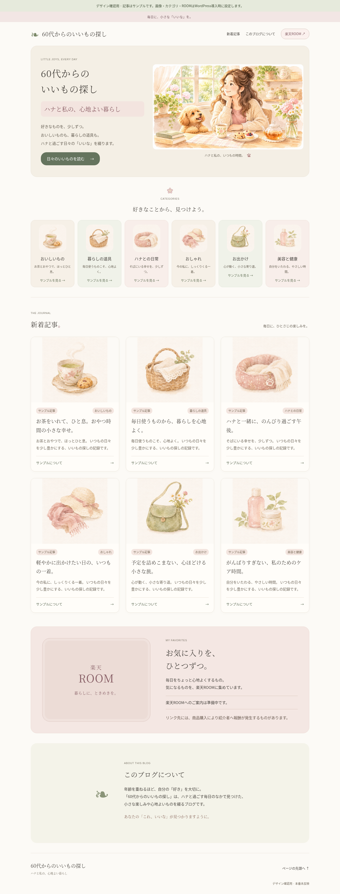

# ハナのトップページ — 「私とハナ」メイン画像入り（1.3）

生成り・アイボリー・淡いグリーンを基調に、くすみピンクと丸みを加えたCocoon Child用の見本です。大人の暮らしブログに合う、控えめな小花・葉っぱ・肉球を添えました。

## 見本を見る

- [PC版の見本画像](preview/desktop.png)
- [スマートフォン版の見本画像](preview/mobile.png)
- [修正版ZIPをダウンロード](https://github.com/orenzipeco2021-sketch/50dai-iimono-blog/raw/refs/heads/hana-cocoon-preview/wordpress-preview/hana-home-package.zip)

ZIPを解凍し、`preview/index.html`をブラウザで開くと、リンクを操作できる見本になります。GitHub上でHTMLファイルをクリックするとコードが表示されるため、画面だけを確認する場合は上の見本画像をご覧ください。

## 今回の変更

2026年11月7日：選択された「私とハナ」の画像を組み込み、PC・スマホの見本とZIPを更新しました。元画像の内容は加工していません。

6カテゴリと記事見本を、AI生成の水彩風画像に変更しました。手描きの原画ではありません。角ばったSVGの線画・静物イラストはこのパッケージから外しました。

| カテゴリ | 新しいイラスト |
|---|---|
| おいしいもの | 花柄の丸いカップとお菓子 |
| 暮らしの道具 | かご・リネン・葉っぱ |
| ハナとの日常 | くつろぎ用クッションと肉球チャーム |
| おしゃれ | 帽子とくすみピンクのストール |
| お出かけ | 淡いグリーンのバッグと小花 |
| 美容と健康 | 丸いボトル・クリーム容器・葉っぱ |

[6種類の水彩風素材を見る](cocoon-child-additions/hana-home/assets/watercolor-sheet.png)

「外観 → カスタマイズ → ハナのトップページ」の各「○○ のイラスト」から、カテゴリごとにJPG・PNG・WebPへ差し替えられます。正方形を推奨。未設定なら同梱の水彩風画像を表示します。

実際の記事のアイキャッチ画像は優先して表示します。アイキャッチがない記事だけ、設定されたカテゴリに応じたイラストを使います。カテゴリ未対応ならかごのイラストです。

メイン画像は、ユーザーが選んでZIPで提供した「私とハナ」のJPGをそのまま使用しています。PCでは文字の右側、幅900px以下では文字の下に配置し、画像全体を表示します。文字の重ね表示や画像の切り抜きはありません。WordPressで別のメイン画像を選択済みの場合はその選択を優先し、未設定なら同梱画像を表示します。プレビュー記事はサンプルです。

## 設置する前に

[はじめに](はじめに.md) → [初心者向け導入手順](導入手順.md) の順にご確認ください。ZIPは完成テーマではなく、既存Cocoon Childに追加するファイル一式です。別のテスト用WordPressで確認してから導入します。

main・公開中GitHub Pages・本番WordPressは未変更です。このフォルダは`hana-cocoon-preview`ブランチだけに保存しています。

## PC版

